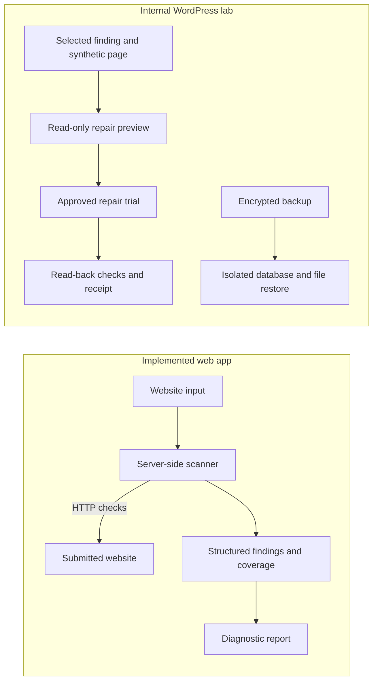
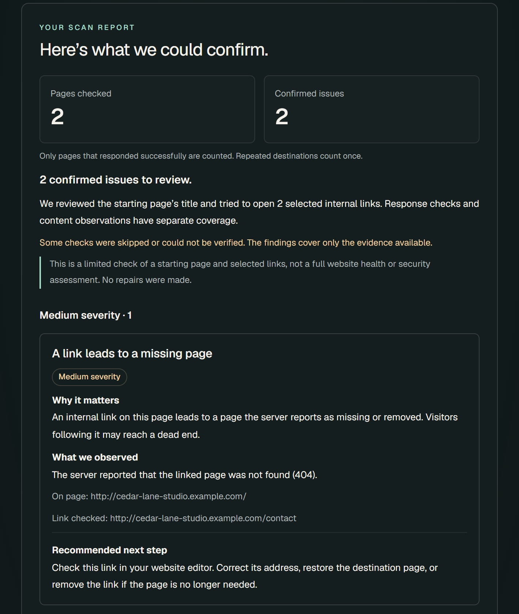
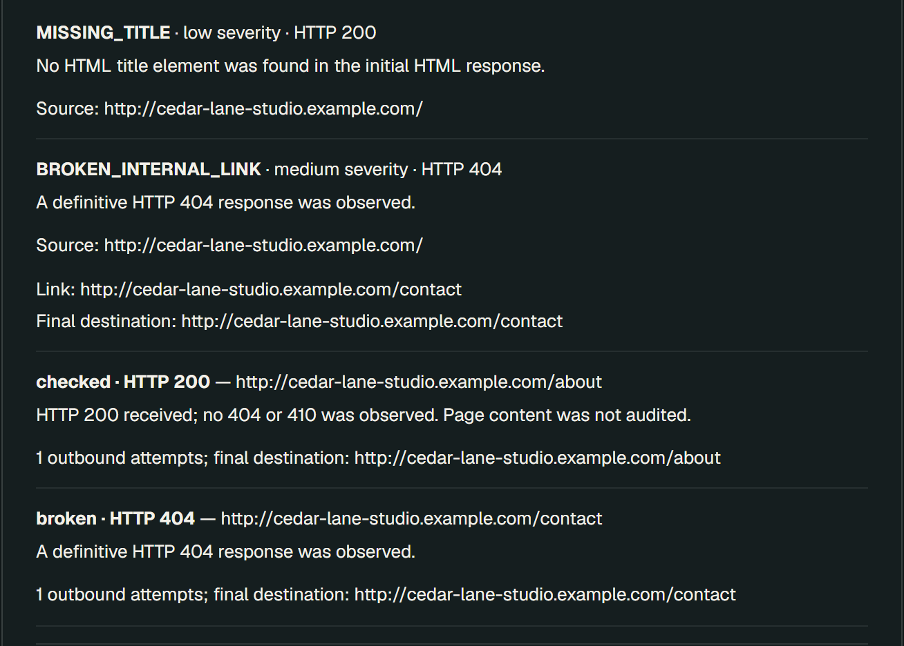

# SitePilot

**Website diagnostics and guided repair for small businesses**

SitePilot is an independently developed commercial SaaS product in active development by [Hector Virrey](https://hectorvirrey.com). The scanner is implemented in the web app. WordPress repair and recovery are internal engineering milestones under development.

## The problem

A broken contact link can prevent an interested customer from reaching a business. The owner may have little time to track down the affected page, reproduce the problem, and decide what to change. A useful report needs to show the evidence, explain the impact, and make clear which checks were incomplete.

SitePilot turns a website address into a plain-language diagnostic report. For a confirmed broken WordPress link, the internal prototype explores the next step: preview a narrowly scoped edit, require explicit approval, verify the result, and retain a way to recover.

## System architecture

The web app and WordPress lab are separate. The lab evaluates the repair workflow with controlled fixtures. A scan report does not trigger edits.

## Implemented capabilities

| Area | What SitePilot demonstrates | Scope |
| --- | --- | --- |
| **Diagnostics** | Inspect the submitted page and a bounded set of eligible internal links. Report missing or empty page titles, confirmed broken links, and basic page and content observations. Distinguish confirmed findings from checks that were skipped or could not be verified. | Web app |
| **Repair** | Read WordPress content in development and preview a single link-target replacement. Exercise approval, apply, and rollback for that narrow repair in controlled tests. | Internal prototype and isolated WordPress/MariaDB fixtures |
| **Verification** | Confirm the intended content change by reading it back, check that surrounding markup is preserved, and record a receipt. Treat content verification and destination reachability as separate checks. | Internal prototype and isolated fixtures |
| **Recovery** | Restore encrypted database and file backups in an isolated environment and compare the recovered database content and file inventory against recorded evidence. | Verified logical recovery in the lab |

## Engineering highlights

- **Reporting under uncertainty.** A confirmed HTTP 404 and a destination that times out call for different advice. Findings carry supporting observations, and the report keeps partial coverage visible so a clean result is easy to interpret.
- **Editing without rewriting the page.** WordPress block markup can carry structure that a general HTML rewrite would disturb. The prototype changes one unambiguous link target and verifies that surrounding content stays byte-for-byte intact.
- **Handling concurrent edits and retries.** A page can change between preview and approval. Integration tests against MariaDB cover competing updates, stale previews, repeated requests, and verification failures. They exercise safe conflict handling and protect against partial or duplicate writes.
- **Proving recovery.** The lab restored a database and file set into disposable fixtures and compared their contents with the recorded snapshot. The exercise verified logical data recovery. WordPress boot and off-device disaster recovery remain outside that test's scope.

## Technology stack

| Layer | Technologies |
| --- | --- |
| Web application | Next.js App Router, React, TypeScript, Tailwind CSS |
| Scanner | Node.js server-side networking, parse5 for HTML parsing |
| WordPress integration lab | WordPress, PHP, Apache, MariaDB, Docker Compose |
| Verification and repository tooling | Node.js test runner, PHP integration checks, ESLint, TypeScript compiler, Gitleaks |

## Testing and reliability

The reviewed private development checkpoint passed **313 Node.js tests**, ESLint, TypeScript checks, and the Next.js production build. The Node suite covers scanner responses, crawl behavior, report generation, and repair transaction cases. Separate WordPress and MariaDB fixture suites passed for configuration, authorization, and repair apply/rollback. Backup permissions and recovery-environment checks also passed. Results describe the development checkpoint and controlled fixtures.

## Roadmap

| Status | Milestone |
| --- | --- |
| **Implemented** | Website input, bounded diagnostics, and evidence-backed reports with coverage and limitations. |
| **Validated in development** | Read-only WordPress inspection, single-link repair preview, approval and conflict tests, exact read-back, isolated rollback and logical recovery. |
| **Planned** | Guided onboarding for verified site owners, a customer-facing approval and repair history, and end-to-end verification of the repaired page as visitors see it. |
| **Planned** | A limited pilot to validate whether the checks and repair guidance are useful in day-to-day site maintenance. |

## Product screenshots

Captured from the existing web app, which displays the provisional **Kaevro** brand. The scanner processed real HTTP responses from a controlled website for Cedar Lane Studio, a fictional ceramics business. The findings shown here come from the scanner's evidence-based checks.

### Start a scan

*Enter a website address to check the starting page and selected internal links.*

### Review the report

*The report flags a missing homepage title and a broken Contact link. It also explains the scan's limited coverage and offers a next step.*

### Inspect the evidence

*Expanded evidence shows the observed responses, including a successful About page and the Contact link's HTTP 404.*

See the [screenshot notes](screenshots/README.md) for the demo conditions. WordPress repair remains an internal lab workflow.

This public showcase documents the product and its engineering. The commercial application source is maintained separately.
